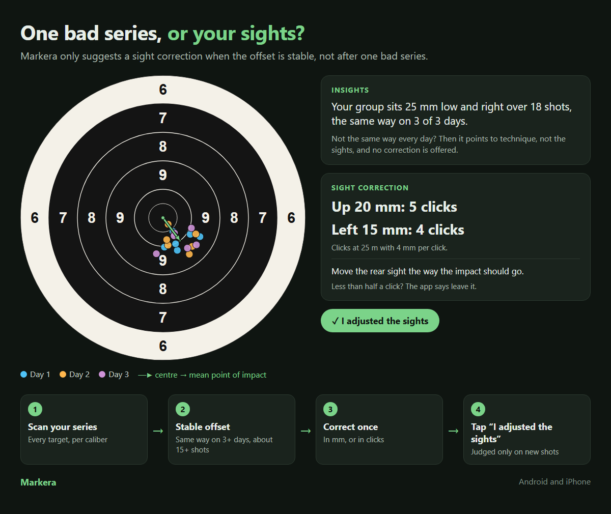
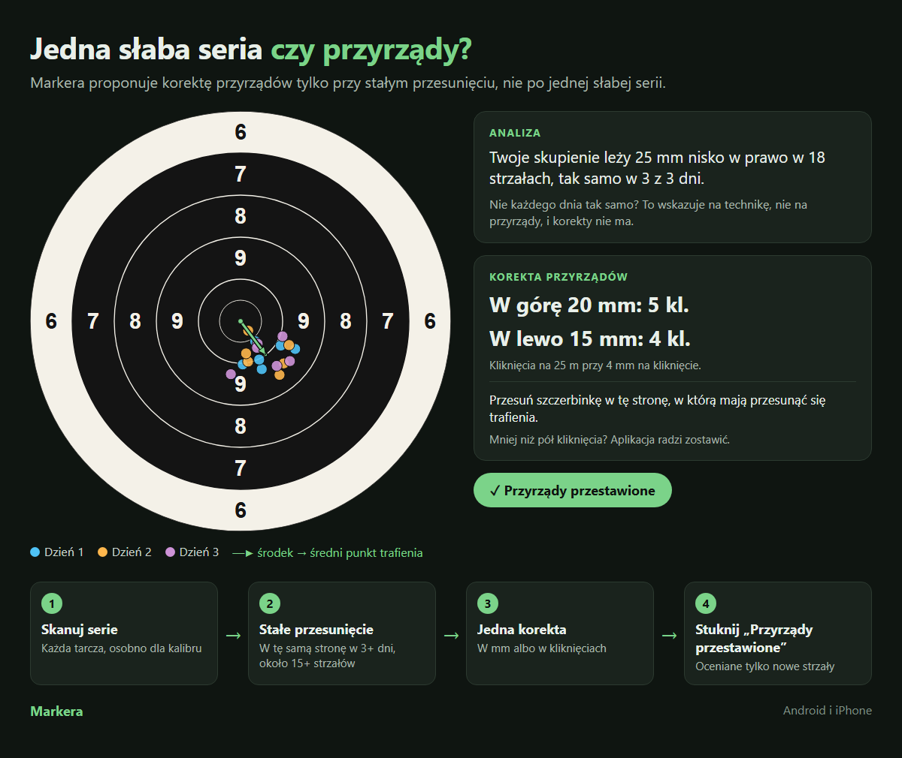
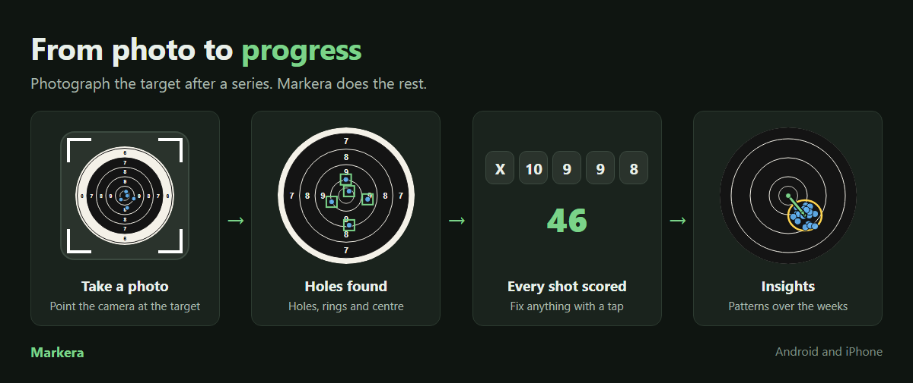
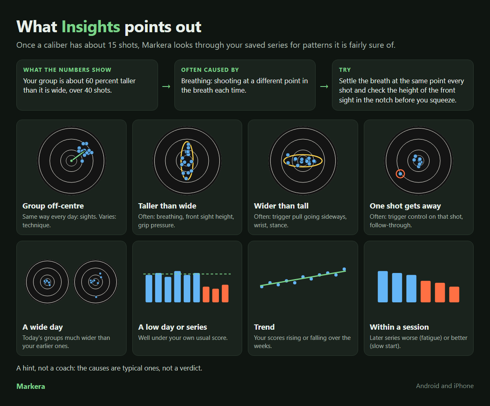
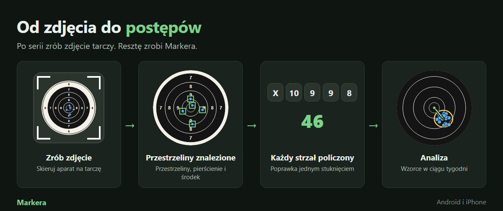
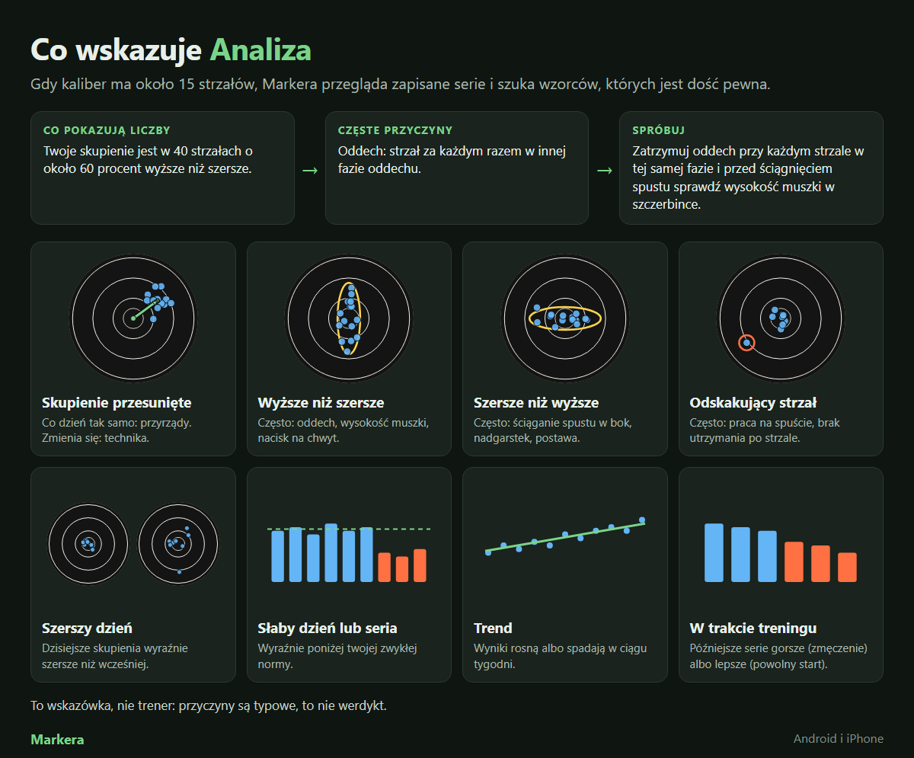

# Markera: posts for a Polish shooting forum

## Where to post

**Primary pick: [forum-bron.pl](https://forum-bron.pl/)**, the biggest Polish firearms forum. It has
threads on sport shooting and dynamic pistol. Its pages refused automated reading (HTTP 403), so I
could not check how active it is now or what its rules (regulamin) say about self-promotion. Read the
regulamin before posting, and use the sport-shooting section or an announcements/software section
if one exists.

**Alternatives**
- Polish Facebook groups for sport shooting (search "strzelectwo sportowe", "strzelectwo pistoletowe").
  These are where most of the day-to-day talk happens now. Check each group's rules on promotion.
- Your contacts in Polish clubs (PZSS-licensed clubs). A post shared by a club instructor reaches the
  right shooters.

**Skip [strzelambolubie.pl](https://www.strzelambolubie.pl/index.php/strzelam-bo-lubie-forum)**:
its newest post is about five years old.

**Before you post**
- Insights, the sight helper and the Polish translation shipped in **1.16.0**. Android has it in
  production; iOS 1.16.0 was still waiting for review on 2026-11-20. Post after the iOS release, or
  keep the "Android now, iPhone soon" line below.
- The Polish text has not been checked by a native speaker. It reuses the app's own Polish terms
  (Analiza, Korekta przyrządów, Przyrządy przestawione, skupienie, szczerbinka, wartość kliknięcia),
  so the post matches the screens.
- Add the App Store link where it says `<App Store link>`.
- Graphics are in `graphics/` (1200 px wide PNGs, EN and PL). Most forums need them uploaded as
  attachments or through an image host. Rebuild with `python docs/marketing/graphics/make_graphics.py`.
- The app reads a precision target with printed ring numbers (6–9). The black is 200 mm across and
  the rings are 25 mm apart. Say so if someone asks which targets work.

---

## Post 1: Sight adjustment between competitions

### English

**Title:** Adjusting your sights between competitions on evidence, not on one bad series (an app, developer here)

Hi all. I'm the developer of Markera, a phone app for precision pistol shooters. You photograph your
target, and it finds the holes and scores the series. I'd like to show one feature I built for a
problem I know from my own shooting.

**The problem:** one bad series at a competition or in training, and it's tempting to turn the
sights. The next day they're wrong the other way. Is the group really off because of the sights, or
was it me that day?

**What Markera does:** it keeps every series you scan, per caliber. In the **Insights** tab it looks
at where your mean point of impact is. It only suggests a sight correction when the offset is
**stable**: the same direction on at least 3 separate days, and at least about 15 shots. If the
offset changes from day to day, it says so and points to technique instead, not the sights.

When the offset is stable you get a **sight correction**:
- How far to move the impact, up/down and left/right, in mm.
- In **clicks** too, once you enter your sights' click value (mm per click) and your distance.
- If the correction is less than half a click, it tells you to leave the sights alone.
- The rule is shown with it: move the rear sight the way you want the hits to go.

After you adjust, tap **"I adjusted the sights"**. From then on the offset is judged only on shots
fired after the adjustment, so you can see whether the correction worked. There is Undo if you tapped
by mistake. The click value and adjustments are stored only on your phone.

So between competitions you can train as usual, scan your targets, and make **one** confident
correction when the data shows it, instead of chasing a single series.

The app is in Polish (and 35 other languages). Android now, iPhone soon:
- Google Play: https://play.google.com/store/apps/details?id=se.kjellstrand.markera
- App Store: `<App Store link>`

Feedback is very welcome, both here and through the app's Suggestion box.

### Polski

**Tytuł:** Korekta przyrządów między zawodami na podstawie danych, a nie jednej słabej serii (aplikacja, piszę jako autor)

Cześć wszystkim. Jestem autorem Markera, aplikacji na telefon dla strzelców pistoletowych
(strzelanie precyzyjne). Robisz zdjęcie tarczy, a aplikacja znajduje przestrzeliny i liczy wynik
serii. Chciałbym pokazać jedną funkcję, którą zrobiłem z myślą o problemie znanym mi z własnego
strzelania.

**Problem:** jedna słaba seria na zawodach albo na treningu i od razu kusi, żeby przekręcić
przyrządy. Następnego dnia skupienie ucieka w drugą stronę. Czy to naprawdę przyrządy, czy po prostu
ja tego dnia?

**Co robi Markera:** zapisuje każdą zeskanowaną serię, osobno dla każdego kalibru. W zakładce
**Analiza** sprawdza, gdzie leży twój średni punkt trafienia. Korektę przyrządów proponuje tylko
wtedy, gdy przesunięcie jest **stałe**: w tę samą stronę w co najmniej 3 różne dni i przy co
najmniej około 15 strzałach. Jeśli przesunięcie zmienia się z dnia na dzień, aplikacja to mówi
i wskazuje raczej na technikę niż na przyrządy.

Gdy przesunięcie jest stałe, dostajesz **korektę przyrządów**:
- O ile przesunąć trafienia w górę/w dół i w lewo/w prawo, w mm.
- Także w **kliknięciach**, gdy wpiszesz wartość kliknięcia swoich przyrządów (mm na kliknięcie)
  i odległość strzelania.
- Jeśli korekta to mniej niż pół kliknięcia, aplikacja radzi zostawić przyrządy.
- Obok jest zasada: przesuń szczerbinkę w tę stronę, w którą mają przesunąć się trafienia.

Po korekcie stuknij **„Przyrządy przestawione”**. Od tej chwili przesunięcie jest oceniane tylko na
podstawie strzałów oddanych później, więc widać, czy korekta zadziałała. Jest też „Cofnij”, gdyby
stuknięcie było przypadkowe. Wartość kliknięcia i korekty są zapisywane tylko w telefonie.

Między zawodami trenujesz więc jak zwykle, skanujesz tarcze i robisz **jedną** pewną korektę, gdy
dane to pokazują, zamiast gonić za pojedynczą serią.

Aplikacja jest po polsku (i w 35 innych językach). Android już teraz, iPhone wkrótce:
- Google Play: https://play.google.com/store/apps/details?id=se.kjellstrand.markera
- App Store: `<App Store link>`

Chętnie przyjmę uwagi, tutaj albo przez skrzynkę sugestii w aplikacji.

---

## Post 2: How the app helps you become a better pistol shooter

### English

**Title:** An app that reads your targets and points out patterns in your shooting (developer here, feedback wanted)

Hi all. I'm the developer of Markera. You photograph your precision target after a series, and the
app finds the holes, the rings and the centre and scores every shot. You can fix anything it missed
with a tap. Over time it builds up your history, and that is where it starts to help you improve.

**Insights.** Once a caliber has about 15 shots, the **Insights** tab looks through your saved
series and points out patterns it is fairly sure of:
- **Group off-centre:** your mean point of impact sits in one direction. If it's the same every day,
  that's likely the sights (see the sight correction). If it varies, it's more likely technique.
- **Stretched group:** taller than wide (breathing, sight picture height, varying grip pressure),
  wider than tall (trigger pull going sideways, wrist, stance), or along a slant.
- **Fliers:** a tight group with one shot getting away in a good share of your series (trigger
  control on that one shot, losing the follow-through, not calling the shot).
- **A wide day or a low day** compared with your own usual, and a **low series**.
- **Trend:** your scores rising or falling over the weeks.
- **Within a session:** later series clearly worse (fatigue) or clearly better (a slow start) on
  several days.

Each finding tells you what the numbers show, what **often causes** it, and **one thing to try**.
For example, for a high group: keep the wrist locked and follow through, holding the sights on the
target until the recoil has passed. The target view draws the group's ellipse, an arrow from the
centre to your mean point of impact, and rings round the fliers. Tap a finding to see what it refers
to.

The Home screen shows the strongest finding of the past 7 days. The app is honest about its limits:
it's a hint, not a coach. The causes are typical ones, not a verdict. You can set your shooting
hand, or turn Insights off, in Settings.

**Also in the app:** history with filters (caliber, tag such as training or competition, date),
statistics with all your hits on one target, trends, and export to CSV/zip.

In Polish and 35 other languages. Android now, iPhone soon:
- Google Play: https://play.google.com/store/apps/details?id=se.kjellstrand.markera
- App Store: `<App Store link>`

I'd love to hear from Polish shooters: does it read your targets well, and are the tips useful?

### Polski

**Tytuł:** Aplikacja, która czyta twoje tarcze i wskazuje wzorce w strzelaniu (piszę jako autor, proszę o opinie)

Cześć wszystkim. Jestem autorem Markera. Po serii robisz zdjęcie tarczy precyzyjnej, a aplikacja
znajduje przestrzeliny, pierścienie i środek, i liczy każdy strzał. To, co przeoczy, poprawisz
jednym stuknięciem. Z czasem powstaje historia twoich serii i właśnie wtedy aplikacja zaczyna
pomagać się poprawiać.

**Analiza.** Gdy dany kaliber ma około 15 strzałów, zakładka **Analiza** przegląda twoje zapisane
serie i wskazuje wzorce, których jest dość pewna:
- **Skupienie przesunięte:** średni punkt trafienia leży w jedną stronę. Jeśli każdego dnia tak samo,
  to raczej przyrządy (zob. korekta przyrządów). Jeśli się zmienia, to raczej technika.
- **Rozciągnięte skupienie:** wyższe niż szersze (oddech, wysokość muszki w szczerbince, zmienny
  nacisk na chwyt), szersze niż wyższe (ściąganie spustu w bok, nadgarstek, postawa) albo po skosie.
- **Odskakujący strzał:** ciasne skupienie, ale w sporej części serii jeden strzał ucieka (kontrola
  spustu przy tym jednym strzale, brak utrzymania po strzale, strzał oddany bez „wywołania”).
- **Szerszy albo słabszy dzień** w porównaniu z twoją normą, a także **słaba seria**.
- **Trend:** wyniki rosną albo spadają w ciągu tygodni.
- **W trakcie treningu:** późniejsze serie wyraźnie gorsze (zmęczenie) albo wyraźnie lepsze (powolny
  start) w kilka różnych dni.

Każda uwaga mówi, co pokazują liczby, co **często to powoduje** i **jedną rzecz do wypróbowania**.
Na przykład przy skupieniu wysoko: trzymaj nadgarstek sztywno i utrzymaj przyrządy na tarczy, aż
minie odrzut. Na tarczy widać elipsę skupienia, strzałkę od środka do średniego punktu trafienia
i zaznaczone odskakujące strzały. Stuknij uwagę, aby zobaczyć, czego dotyczy.

Ekran główny pokazuje najmocniejszą uwagę z ostatnich 7 dni. Aplikacja uczciwie mówi o swoich
granicach: to wskazówka, nie trener. Przyczyny są typowe, to nie werdykt. Rękę strzelecką ustawisz,
a Analizę wyłączysz w Ustawieniach.

**Poza tym:** historia z filtrami (kaliber, etykieta, np. trening albo zawody, data), statystyki ze
wszystkimi trafieniami na jednej tarczy, trendy i eksport do CSV/zip.

Po polsku i w 35 innych językach. Android już teraz, iPhone wkrótce:
- Google Play: https://play.google.com/store/apps/details?id=se.kjellstrand.markera
- App Store: `<App Store link>`

Chętnie usłyszę polskich strzelców: czy aplikacja dobrze czyta wasze tarcze i czy wskazówki są
przydatne?
